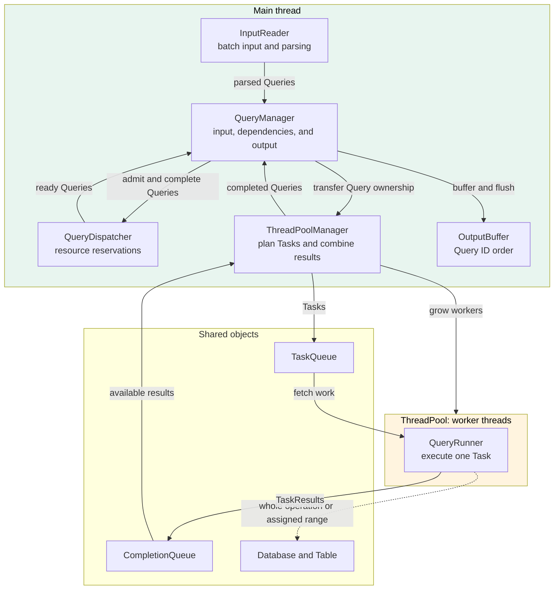

# mangoDB

## Description

mangoDB is a C++20 simple in-memory database. It reads a stream of commands, schedules compatible Queries concurrently, and divides large table operations into Tasks. Dependency scheduling preserves conflicting read/write order, while an output buffer publishes results in Query ID order.

## Basic Structure



The main thread manages input, Query dependencies, Task phases, and ordered output. Worker threads execute Tasks and return owned partial results.

## Features

- **Data operations:** INSERT, UPDATE, DELETE, DUPLICATE, SUB, SWAP, SELECT, SUM, and MAX.
- **Table and file operations:** LOAD, DUMP, DROP, TRUNCATE, COPYTABLE, LIST, SHOWTABLE, and QUIT.
- **Two levels of parallelism:** independent Queries can overlap, and one eligible Query can scan disjoint ranges of a large table concurrently.
- **Ordered dependencies and output:** table/file read-write ensures execution order; displayed results retain input order.
- **Efficient KEY filters:** equality lookup visits one candidate and avoids full-table scanning and unnecessary range Tasks.
- **Operation-specific execution:** numeric updates modify disjoint rows directly; structural updates collect keys before one exclusive application phase.
- **Configurable execution:** a single-thread path creates no worker pool; multithreaded execution grows workers as Task supply increases.

## Build

```bash
cmake -S . -B build -DCMAKE_BUILD_TYPE=Release
cmake --build build --parallel
```

For a debug build:

```bash
cmake -S . -B build-debug -DCMAKE_BUILD_TYPE=Debug
cmake --build build-debug --parallel
```

## Run

```bash
./build/mangoDB --listen path/to/file.query --threads=64
./build/mangoDB --listen path/to/file.query --threads=1
```

`--threads=0` auto-detects the logical-core count and uses it as the worker limit. `--threads=1` executes entirely on the calling thread. Other positive values bound the worker pool in addition to the control thread.

Release builds require `--listen`. To read standard input explicitly:

```bash
./build/mangoDB --listen /dev/stdin < path/to/file.query
```

Queries end with `;`. The input stream ends at EOF or QUIT; accepted work finishes before shutdown.

## Documentation

- [Wiki navigation](https://github.com/A-lexisL/mangoDB/wiki)
- [Project architecture and walkthrough](https://github.com/A-lexisL/mangoDB/wiki/Multithread)
- [Optimization and experiment records](https://github.com/A-lexisL/mangoDB/wiki/Optimization)
- [Test Framework](https://github.com/A-lexisL/mangoDB/wiki/Test-Framework): correctness checks, benchmarks, sanitizer/Valgrind builds, and static checks.

## Authors

[Shirui Liang](https://github.com/A-lexisL), [Qiwei Gu](https://github.com/lightblue113), Minyu Cao

